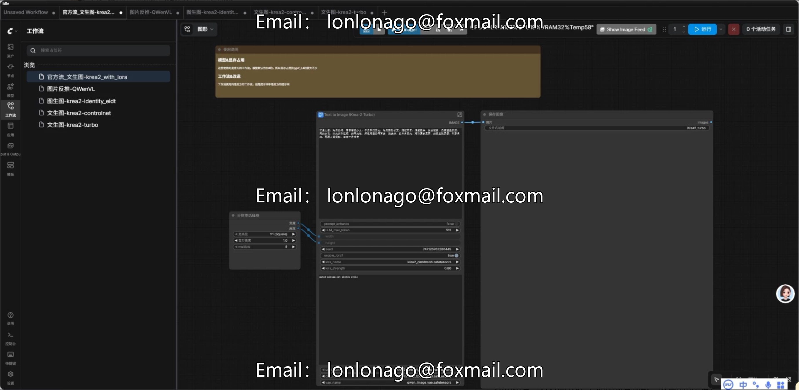
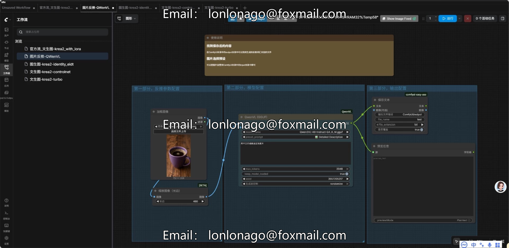
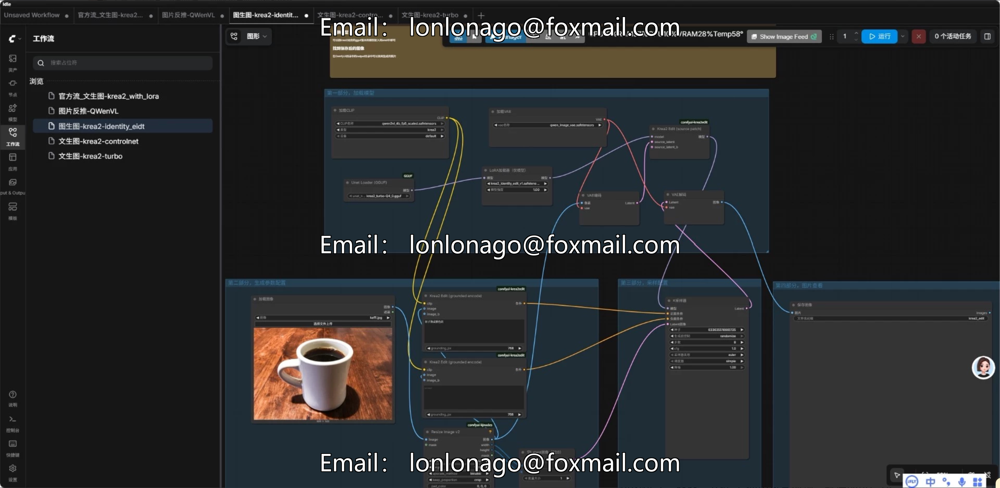
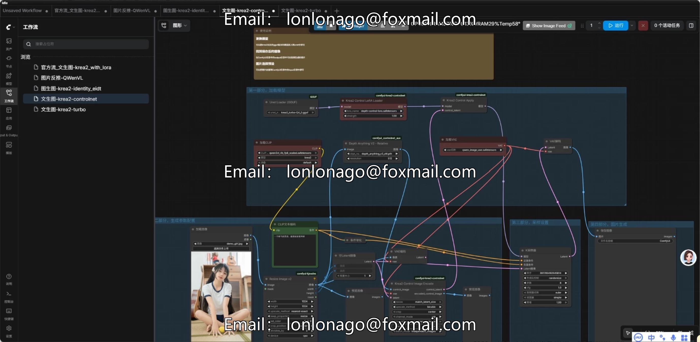
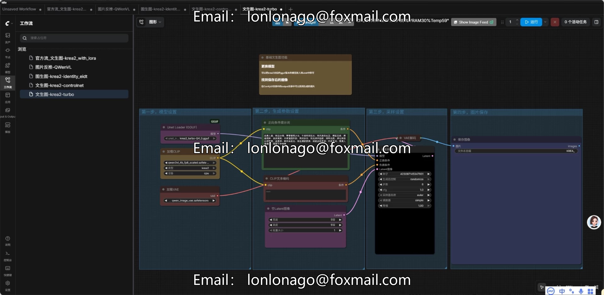

# 2026 Latest Krea2 ComfyUI integration package AI drawing

## Body

2026 Latest Krea2 ComfyUI integration package with AI painting local deployment, 8GB GPU memory, one-click startup, plus a teaching video and 397 styles.
The Krea2 ComfyUI one-click integration package is preconfigured and ready to use upon delivery, eliminating the need for downloading models or adjusting environments on your own, saving a significant amount of time. All computations are completed locally on your device, without the need for cloud membership, ensuring that your creative data is independently controllable.

Core Features
Visualization of text into images, support for loading LoRA models, default fp8 precision with GGUF low memory mode, stable operation with 8GB memory.
Supports multiple creative modes including image generation from text and style transfer.
Inbuilt ControlNet, supports precise picture adjustments such as depth maps and pose control.
Equipped with Qwen-VL prompt word inference, automatically generates corresponding prompt words upon uploading an image.
Includes 397 styles for one-click switches, no need for additional configuration adjustments.

Operating System Requirements
System: Only supports Windows systems.
Graphics Card: At least 8GB of video memory, the larger the video memory, the faster the running speed.
Storage: Ensure sufficient disk space for storing model files.
Mac and Linux systems are not supported.

Package includes
Complete integration files + instructional videos, ready to launch upon extraction, making it easy for beginners to get started.

Purchase Notice
This product is a virtual digital resource, and it is replicable. Once delivered, non-file corruption issues will not be covered. Please confirm your requirements and hardware configuration before placing an order.
The resources are for personal study and research only. Please comply with relevant open-source agreements and laws and regulations, and prohibit reselling or distributing them in any form.
The actual operational effect and generation speed are influenced by individual hardware configuration, and the local performance is the standard.

## Images

## Payment

Here is a pay link on Stripe ( https://buy.stripe.com/3cs8yP7sY87d0vu9AB ). Please contact me lonlonago@foxmail.com after funding $89, and I will send you a complete data files , thank you!

